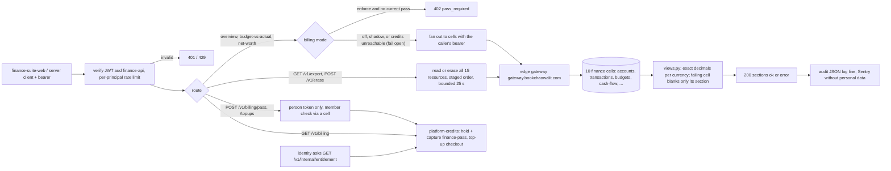
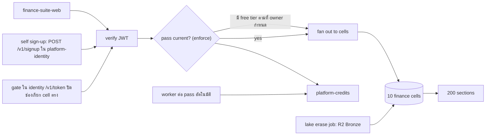

# 01 — Business process (As-Is / To-Be)

finance-api คือ BFF แบบ stateless ของ finance suite: เว็บ finance-suite-web และ client ฝั่งเซิร์ฟเวอร์เรียกครั้งเดียวเพื่อได้ภาพรวมการเงิน (overview, budget vs actual, net worth) ที่รวมจาก 10 finance cells โดยส่ง bearer ของผู้เรียกต่อไปให้แต่ละ cell; นอกจากนั้นให้ export/erase ตาม PDPA และขายแพ็กเกจรายเดือน (pass) ด้วยเครดิตจาก platform-credits ซึ่ง finance-api ไม่มีฐานข้อมูลของตัวเอง

Last reviewed: 2026-11-27 · commit `192dc4b`

## As-Is (จากโค้ดวันนี้)

Sources: `src/finance_api/app.py`, `src/finance_api/cells.py`, `src/finance_api/views.py`, `src/finance_api/billing.py`, `src/finance_api/auth.py`, `src/finance_api/gateway.py`, `README.md`, `PRODUCT.md`, `specs/004-pdpa-export-erase/spec.md`, `specs/005-monthly-pass/spec.md`, `specs/006-entitlement-for-identity/spec.md`

ข้อเท็จจริงสำคัญจากโค้ด:

- `FINANCE_API_BILLING_MODE` default คือ `off`; โหมด `shadow` แค่ log `finance-api.pass_missing`, `enforce` ตอบ 402; `/v1/export`, `/v1/erase` และ route billing ไม่ถูก gate
- เมื่อ credits/identity ตอบไม่ได้ gate ปล่อยผ่าน (fail open) และ log `finance-api.pass_unknown`
- token แบบ delegated (agent) ถูกปฏิเสธที่ route ซื้อ pass และ top-up
- โหมด billing ที่ production ตั้งไว้จริงตอนนี้อ่านไม่ได้จากโค้ด [ต้องยืนยัน]
- `finance-suite-web` ใน `PRODUCT.md` ยังเป็น "planned"; สถานะ deploy จริงของเว็บ [ต้องยืนยัน]

## To-Be (จาก `docs/PHASE-6-SAAS.md`, `specs/005-monthly-pass`, `specs/004-pdpa-export-erase`)

Sources: `docs/PHASE-6-SAAS.md` (Provisioning, Billing), `specs/005-monthly-pass/spec.md` §2 (out of scope "later"), `specs/004-pdpa-export-erase/spec.md` §6

## Gap

| ID | As-Is → To-Be | Status | Owner | Evidence |
|---|---|---|---|---|
| G1 | ไม่มี self sign-up (สร้าง workspace ด้วยมือใน platform-empire) → `platform.signup` + `POST /v1/signup` + kill switch | decide | owner | `docs/PHASE-6-SAAS.md` "Provisioning — proposed design (needs approval)" |
| G2 | pass ต่อเองไม่ได้ → ต่ออัตโนมัติโดย worker | todo | claude | `specs/005-monthly-pass/spec.md` §2 "Automatic renewal (a worker, later)" |
| G3 | ไม่มี free tier หรือ trial → owner กำหนดราคา ขอบเขต free tier และเวลา enforce | decide | owner | `specs/005-monthly-pass/spec.md` §2, Approval note; `docs/PHASE-6-SAAS.md` "Owner decisions" |
| G4 | bundle token ยังเรียก cell ตรงผ่าน gateway ได้โดยไม่ต้องมี pass → gate ใน identity `/v1/token` | todo | claude | `specs/005-monthly-pass/spec.md` §2 ("a later spec") |
| G5 | ข้อมูลอ้างอิงใน R2 Bronze ไม่ถูกลบตอน erase → lake erase job | todo | claude | `specs/004-pdpa-export-erase/spec.md` §6 |
| G6 | export เกิน 1 MiB ของ gateway ใช้ไม่ได้ → เพิ่ม `max_body_bytes` ให้ route `finance-api` | blocked | owner | `specs/004-pdpa-export-erase/spec.md` change log 1.1 (gateway owner) |
| G7 | ใครมีสิทธิ์ซื้อ pass ในเวิร์กสเปซ (billing role) ยังไม่กำหนด → ตัดสินใจ | decide | owner | `specs/005-monthly-pass/spec.md` AC-03 |

## Open questions

- production ตั้ง `FINANCE_API_BILLING_MODE` เป็นอะไร (off, shadow, enforce)
- สถานะ deploy ของ `finance-suite-web` (PRODUCT.md เขียนว่า planned)
- ใบแจ้งหนี้/ใบกำกับภาษี อยู่นอกขอบเขตของ spec 005 และไม่มี To-Be ที่เขียนไว้
